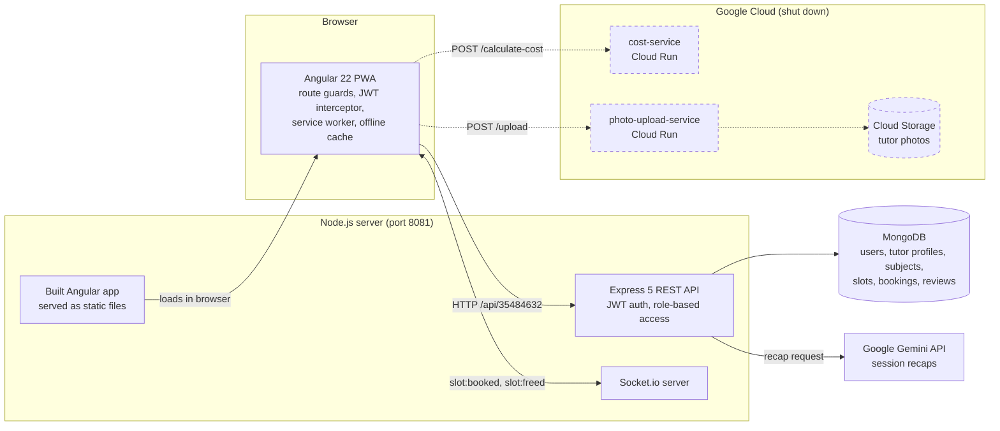
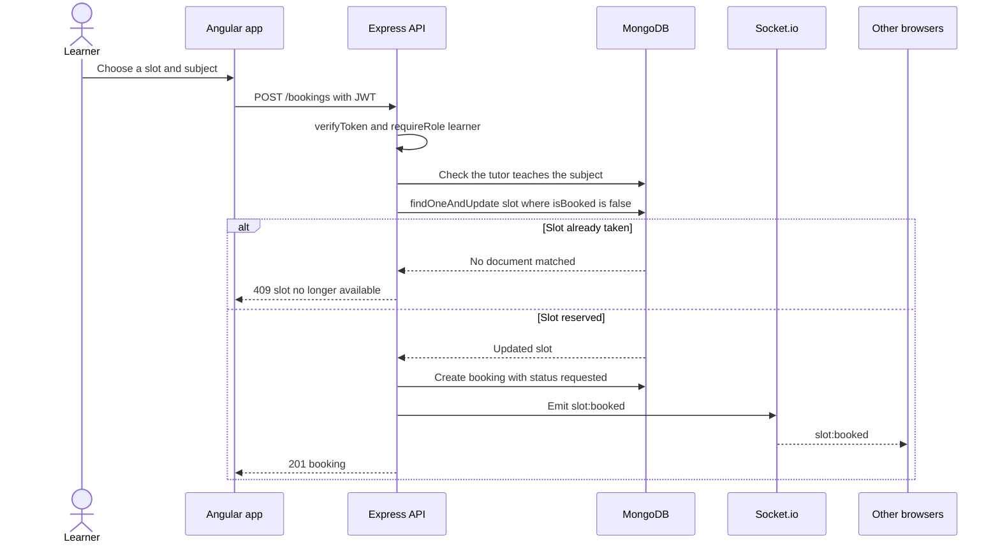

# StudyBridge

A full-stack tutoring marketplace where learners find and book tutors, tutors manage their profiles and availability, and admins view marketplace analytics.

> **Coursework note:** this project was built for **Monash University FIT2095** (Student ID: 35484632). Assignment 2 delivered the REST API; Assignment 3 added the Angular client, real-time updates, offline support and cloud services.

## Features

**Learners**

- Register, log in, and search tutors by subject and minimum rating
- View tutor profiles and book an available slot, with a live cost preview
- Manage bookings (cancel, review completed sessions)

**Tutors**

- Manage a profile (bio, hourly rate, subjects, photo)
- Publish and remove availability slots
- Confirm, complete, or cancel sessions
- Generate an AI-written session recap from their own notes (Gemini)

**Admins**

- View marketplace analytics on the dashboard: top subjects, top tutors, completion and cancellation rates, estimated platform revenue

**Platform**

- JWT authentication with server-side token invalidation on logout, and role-based access control (learner / tutor / admin)
- Atomic slot booking, so two learners cannot book the same slot
- API-level features without a UI yet: subject catalogue management (admin), tutor recommendations for learners, and reliability scores based on cancellation history
- Real-time slot availability across browsers via Socket.io
- Progressive Web App with a service worker and read-only offline access to the latest tutor search and bookings

## Tech stack

| Layer         | Technology                                                                                        |
| ------------- | ------------------------------------------------------------------------------------------------- |
| Frontend      | Angular 22, TypeScript, Bootstrap 5, RxJS, Socket.io client, Angular service worker (PWA), Vitest |
| Backend       | Node.js, Express 5, Mongoose 9, MongoDB, JWT, bcrypt, Socket.io                                   |
| AI            | Google Gemini (`@google/genai`) for session recaps                                                |
| Microservices | `cost-service` (Express), `photo-upload-service` (Express, Multer, Google Cloud Storage)          |
| Cloud         | Google Cloud Run and Cloud Storage (see [Project status](#project-status))                        |

## Repository structure

```text
StudyBridge/
├── backend/               REST API, Socket.io server, seed script
├── frontend/              Angular application (PWA)
├── cost-service/          Session cost calculator microservice
└── photo-upload-service/  Tutor photo upload microservice
```

## Architecture



Dashed boxes and arrows are the Google Cloud services that are no longer running (see [Project status](#project-status)).

### Booking flow

Booking uses an atomic update on the slot, so two learners cannot reserve the same one, and every connected browser is told when a slot changes.



## Getting started

### Prerequisites

- A current Node.js LTS release (the backend uses `node --env-file`, which needs Node 20.6 or later)
- A running MongoDB instance, local or hosted

### 1. Backend

```bash
cd backend
npm install
cp .env.example .env     # then edit the values
npm run seed             # loads demo data
npm run dev              # API on http://localhost:8081
```

`.env` values:

| Variable         | Purpose                                                                           |
| ---------------- | --------------------------------------------------------------------------------- |
| `MONGO_URI`      | MongoDB connection string                                                         |
| `JWT_SECRET`     | Secret used to sign tokens; use a long random string                              |
| `PORT`           | API port (default `8081`)                                                         |
| `GEMINI_API_KEY` | Optional. Only needed for AI session recaps; the rest of the app works without it |

All API routes are served under `/api/35484632`.

### 2. Frontend (development)

```bash
cd frontend
npm install
npm start                # http://localhost:4200
```

The development server talks to the API at `http://localhost:8081`, which allows the `http://localhost:4200` origin.

### 3. Production-style run (single server)

```bash
cd frontend
npm run build
cd ../backend
npm start                # serves the API and the built Angular app on port 8081
```

## Demo accounts

The seed script creates these accounts. They are for local demos only.

| Role    | Email                                                                                                                 | Password       |
| ------- | --------------------------------------------------------------------------------------------------------------------- | -------------- |
| Admin   | `admin@studybridge.com`                                                                                               | `Admin#2026`   |
| Learner | `task4.learner@studybridge.test`                                                                                      | `Learner#2026` |
| Tutor   | `alice.chen@studybridge.test` (also `ben.carter`, `priya.nair`, `liam.wong`, `sofia.martinez` at `@studybridge.test`) | `Tutor#2026`   |

## API overview

Base path: `/api/35484632`

| Area     | Endpoints                                                                                                                                                    |
| -------- | ------------------------------------------------------------------------------------------------------------------------------------------------------------ |
| Auth     | `POST /auth/register`, `POST /auth/login`, `GET /auth/me`, `POST /auth/logout`                                                                               |
| Tutors   | `POST /tutors/profile`, `PUT /tutors/profile`, `GET /tutors/search`, `GET /tutors/:userId`                                                                   |
| Subjects | `GET /subjects`, `GET /subjects/:id`, `POST /subjects`, `PUT /subjects/:id`, `DELETE /subjects/:id`                                                          |
| Slots    | `POST /slots`, `GET /slots/mine`, `DELETE /slots/:slotId`                                                                                                    |
| Bookings | `POST /bookings`, `GET /bookings/mine`, `PATCH /bookings/:id/confirm`, `.../complete`, `.../cancel`, `POST /bookings/:id/review`, `POST /bookings/:id/recap` |
| Learners | `GET /learners/me/recommendations`                                                                                                                           |
| Admin    | `GET /admin/analytics`                                                                                                                                       |

More detail on the backend design is in [`backend/README.md`](backend/README.md).

## Project status

This is a finished university assignment, kept here as a portfolio piece.

- **Cloud services have been shut down.** `cost-service` and `photo-upload-service` were deployed on Google Cloud Run under a university-provided cloud account, which has since been reclaimed. The URLs in `frontend/src/environments/` therefore no longer respond, so the **live cost preview** and **tutor photo upload** features will not work when you run the project. The service code is included for reference, and everything else (authentication, search, bookings, real-time slots, analytics, recommendations) runs locally without them.
- **Backend cloud deployment (Assignment 2) was not completed.** The attempted Google Cloud VM setup hit a MongoDB incompatibility after a kernel update, so the API was never kept running in the cloud.
- To run the two services yourself, see `cost-service/` and `photo-upload-service/` (the latter needs a Cloud Storage bucket, set with `GCS_BUCKET_NAME`) and update the URLs in `frontend/src/environments/`.

## Author

Xiaoyu Zhou
